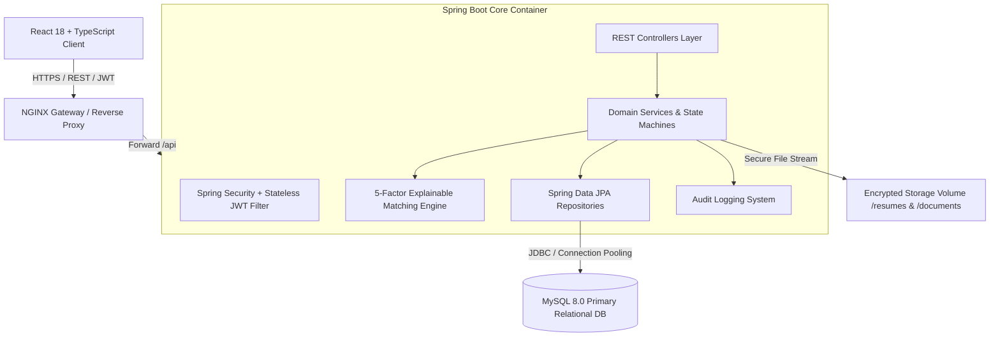
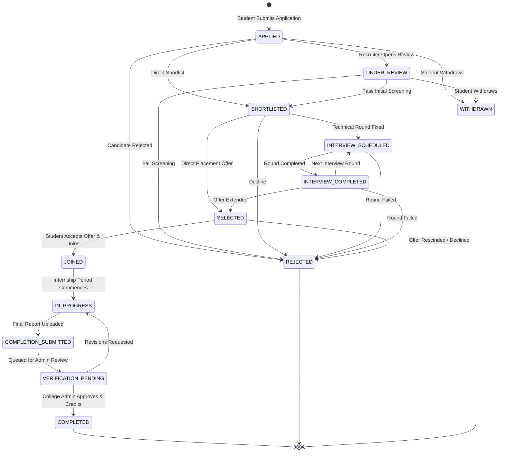

# InternFlow System Architecture Document

## 1. High-Level Architectural Topology

InternFlow follows a layered, domain-driven architecture designed for enterprise horizontal scalability, high transaction throughput, and strict security isolation.



---

## 2. Strict 12-Stage Application State Machine

Applications transition strictly according to the platform state machine. Any arbitrary jump or bypass throws `InvalidStateTransitionException` and generates an audit log warning.



### Transition Validation Rules
1. **Withdrawal Constraint**: A candidate may only withdraw when the application is in early stages (`APPLIED`, `UNDER_REVIEW`). Once an interview is scheduled or an offer extended, withdrawals require administrative clearance.
2. **Deterministic Stage Progression**: Moving to `JOINED` requires verified student placement records.
3. **Completion Clearance**: An internship is only marked `COMPLETED` once the College Placement Office authenticates the corporate completion certificate and evaluation report.

---

## 3. Explainable 5-Factor Matching Algorithm

Unlike opaque neural approaches that hallucinate recommendations, InternFlow implements a **deterministic, explainable algorithm** grounded in candidate competencies, academic thresholds, and experiential track records.

$$\text{Total Match Score} = S_{\text{req}} + S_{\text{pref}} + S_{\text{exp}} + S_{\text{acad}} + S_{\text{comp}}$$

### Mathematical Weight Formulation:

| Component | Weight | Max Points | Formulation & Rules |
| :--- | :---: | :---: | :--- |
| **Required Skills** ($S_{\text{req}}$) | 40% | 40 pts | $\frac{\text{Matched Required Skills}}{\text{Total Required Skills}} \times 40$<br>Canonical aliases automatically resolved. |
| **Preferred Skills** ($S_{\text{pref}}$) | 20% | 20 pts | $\frac{\text{Matched Preferred Skills}}{\text{Total Preferred Skills}} \times 20$<br>Evaluates bonus qualifications. |
| **Projects & Experience** ($S_{\text{exp}}$) | 15% | 15 pts | - Base: 5 pts for relevant verified projects<br>- Tech stack relevance: Up to 5 pts<br>- Prior internship experience: Up to 5 pts |
| **Academics & CGPA** ($S_{\text{acad}}$) | 15% | 15 pts | - If Student CGPA $\ge$ Min Required CGPA: 10 pts base<br>- Proportional bonus: $\min\left(5, \frac{\text{CGPA} - \text{Min}}{\text{10} - \text{Min}} \times 5\right)$<br>- Branch matching bonus included |
| **Profile Completeness** ($S_{\text{comp}}$) | 10% | 10 pts | Completeness percentage of resume, bio, certifications, and LinkedIn/GitHub profiles ($\times 10$) |

### Hard Eligibility Filters
Before the score is computed, hard gate constraints are evaluated:
- **CGPA Gate**: $\text{Student CGPA} \ge \text{Posting Minimum CGPA}$
- **Graduation Year Gate**: Target graduation batch compatibility
- **Branch Gate**: Comma-separated allowed majors (`Computer Science`, `IT`, `Electronics`, etc.)

If any hard filter fails, `eligible = false`, and actionable notifications list exact remediation steps.

---

## 4. Canonical Skill Normalization Pipeline

Raw candidate input strings (e.g., `"react.js"`, `"ReactJS"`, `"k8s"`, `"golang"`) pass through the canonical resolution pipeline before storage or matching:

```
[Raw User Input: "k8s"]
         │
         ▼
[Trim & Lowercase: "k8s"]
         │
         ▼
[Check Canonical Skill Table] ──(Not Direct Match)──► [Check Skill Alias Mapping Table]
                                                                  │
                                                                  ▼
                                                      Found Alias: "k8s" → ID: 22
                                                                  │
                                                                  ▼
                                                  Canonicalized to: "Kubernetes"
```

This guarantees 100% precision in search, filtering, and scoring across diverse terminology used by students and recruiters.
