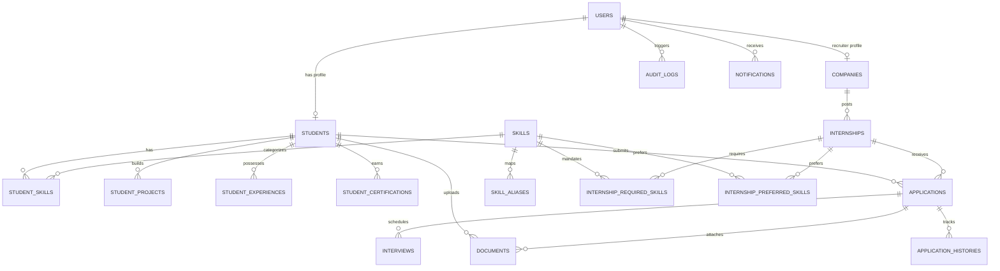

# InternFlow Relational Database Specification

InternFlow's relational schema is designed with full 3NF normalization, strict foreign key constraints, composite unique indexes, and versioned Flyway migrations.

---

## 1. Entity-Relationship Diagram (ERD)

---

## 2. Core Relational Tables & Constraints

### `users`
- `id` BIGINT PRIMARY KEY AUTO_INCREMENT
- `email` VARCHAR(255) UNIQUE NOT NULL (Index: `idx_users_email`)
- `password_hash` VARCHAR(255) NOT NULL
- `role` VARCHAR(50) NOT NULL (`STUDENT`, `COMPANY`, `ADMIN`)
- `is_active` BOOLEAN DEFAULT TRUE
- `created_at`, `updated_at` TIMESTAMP

### `students`
- `id` BIGINT PRIMARY KEY AUTO_INCREMENT
- `user_id` BIGINT UNIQUE NOT NULL (FK: `users.id`)
- `first_name`, `last_name` VARCHAR(100) NOT NULL
- `phone` VARCHAR(20)
- `college` VARCHAR(255) NOT NULL
- `degree` VARCHAR(100) NOT NULL
- `branch` VARCHAR(100) NOT NULL (Index: `idx_students_branch`)
- `graduation_year` INT NOT NULL (Index: `idx_students_grad_year`)
- `cgpa` DECIMAL(3, 2) NOT NULL (Index: `idx_students_cgpa`)
- `profile_completion_percentage` INT DEFAULT 0

### `companies`
- `id` BIGINT PRIMARY KEY AUTO_INCREMENT
- `user_id` BIGINT UNIQUE NOT NULL (FK: `users.id`)
- `company_name` VARCHAR(255) NOT NULL (Index: `idx_companies_name`)
- `website` VARCHAR(255)
- `industry` VARCHAR(100)
- `location` VARCHAR(150)
- `verification_status` VARCHAR(50) NOT NULL DEFAULT 'PENDING' (`PENDING`, `APPROVED`, `REJECTED`, `SUSPENDED`)
- `rejection_reason` TEXT
- `verified_at` TIMESTAMP

### `internships`
- `id` BIGINT PRIMARY KEY AUTO_INCREMENT
- `company_id` BIGINT NOT NULL (FK: `companies.id`)
- `title` VARCHAR(255) NOT NULL
- `description` TEXT NOT NULL
- `work_mode` VARCHAR(50) NOT NULL (`REMOTE`, `ON_SITE`, `HYBRID`)
- `duration_months` INT NOT NULL
- `stipend_per_month` DECIMAL(10, 2) NOT NULL
- `min_cgpa` DECIMAL(3, 2) DEFAULT 0.00
- `allowed_branches` VARCHAR(255)
- `graduation_year` INT
- `application_deadline` TIMESTAMP NOT NULL
- `openings` INT NOT NULL DEFAULT 1
- `status` VARCHAR(50) NOT NULL DEFAULT 'PENDING_APPROVAL' (`DRAFT`, `PENDING_APPROVAL`, `APPROVED`, `PUBLISHED`, `CLOSED`, `ARCHIVED`)
- `approved_by` BIGINT (FK: `users.id`)

### `applications`
- `id` BIGINT PRIMARY KEY AUTO_INCREMENT
- `internship_id` BIGINT NOT NULL (FK: `internships.id`)
- `student_id` BIGINT NOT NULL (FK: `students.id`)
- `current_status` VARCHAR(50) NOT NULL DEFAULT 'APPLIED' (Index: `idx_applications_status`)
- `cover_note` TEXT
- `match_score_at_application` INT
- `applied_at` TIMESTAMP NOT NULL
- **UNIQUE CONSTRAINT**: `uk_internship_student (internship_id, student_id)` — *Guarantees students cannot submit duplicate applications to the same posting.*

### `application_histories`
- `id` BIGINT PRIMARY KEY AUTO_INCREMENT
- `application_id` BIGINT NOT NULL (FK: `applications.id`)
- `from_status` VARCHAR(50)
- `to_status` VARCHAR(50) NOT NULL
- `changed_by_user_id` BIGINT NOT NULL (FK: `users.id`)
- `notes` TEXT
- `created_at` TIMESTAMP NOT NULL

### `interviews`
- `id` BIGINT PRIMARY KEY AUTO_INCREMENT
- `application_id` BIGINT NOT NULL (FK: `applications.id`)
- `scheduled_at` TIMESTAMP NOT NULL (Index: `idx_interviews_scheduled`)
- `meeting_link` VARCHAR(500)
- `mode` VARCHAR(50) NOT NULL (`ONLINE`, `IN_PERSON`, `PHONE`)
- `status` VARCHAR(50) NOT NULL DEFAULT 'SCHEDULED' (`SCHEDULED`, `RESCHEDULED`, `COMPLETED`, `CANCELLED`)
- `feedback` TEXT
- `rating` INT (1 to 5)

### `documents`
- `id` BIGINT PRIMARY KEY AUTO_INCREMENT
- `student_id` BIGINT NOT NULL (FK: `students.id`)
- `application_id` BIGINT (FK: `applications.id`)
- `document_type` VARCHAR(50) NOT NULL (`RESUME`, `OFFER_LETTER`, `JOINING_REPORT`, `COMPLETION_CERTIFICATE`, `EVALUATION_REPORT`)
- `file_name` VARCHAR(255) NOT NULL
- `storage_path` VARCHAR(500) NOT NULL
- `file_size` BIGINT NOT NULL
- `mime_type` VARCHAR(100) NOT NULL
- `verification_status` VARCHAR(50) NOT NULL DEFAULT 'PENDING' (`PENDING`, `VERIFIED`, `REJECTED`)
- `rejection_reason` TEXT
- `uploaded_at` TIMESTAMP NOT NULL

### `skills` & `skill_aliases`
- Canonical skills categorized into `Programming Languages`, `Frameworks & Libraries`, `Cloud & DevOps`, `Databases`, `AI & Machine Learning`, `Core CS`.
- Unique indexes on `skills.canonical_name` and `skill_aliases.alias` enforce normalized taxonomy.

### `audit_logs`
- Append-only immutable log: `user_id`, `user_email`, `role`, `action`, `entity_name`, `entity_id`, `previous_state`, `new_state`, `ip_address`, `details`, `created_at`.

---

## 3. Flyway Versioned Migrations

All DDL and baseline seeds are managed through Flyway in `backend/src/main/resources/db/migration/`:
- **`V1__initial_schema.sql`**: Complete relational DDL with tables, foreign key constraints, and performance indexes.
- **`V2__seed_canonical_skills.sql`**: 40 canonical skills and aliases.
- **`V3__seed_demo_platform_data.sql`**: Realistic test accounts, internships, applications, interviews, documents, and audit entries.
