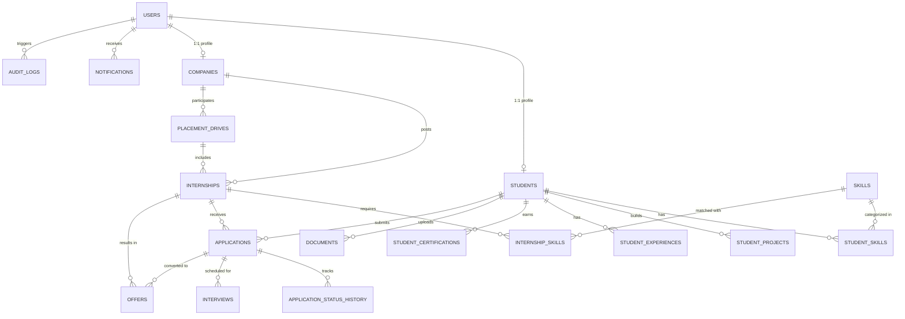

# InternFlow — Database Design & Schema Specification

## 1. Relational Database Overview
InternFlow uses **PostgreSQL 16** as its primary production relational database. Schema consistency, migrations, and seed management are handled via **Flyway**.
Hibernate DDL auto-generation is disabled (`ddl-auto: validate`) to ensure that all schema definitions are version-controlled, auditable, and reproducible across environments.

## 2. Entity Relationship Diagram (ERD)

## 3. Core Relational Tables & Constraints

### 3.1 `users`
- `id`: `BIGINT GENERATED BY DEFAULT AS IDENTITY PRIMARY KEY`
- `email`: `VARCHAR(150) NOT NULL UNIQUE`
- `password_hash`: `VARCHAR(255) NOT NULL` (BCrypt)
- `role`: `VARCHAR(50) NOT NULL` (`STUDENT`, `TPO`, `RECRUITER`, `FACULTY_COORDINATOR`, `ADMIN`)
- `is_active`: `BOOLEAN NOT NULL DEFAULT TRUE`
- `created_at`, `updated_at`: `TIMESTAMP NOT NULL DEFAULT CURRENT_TIMESTAMP`

### 3.2 `students`
- `id`: `BIGINT GENERATED BY DEFAULT AS IDENTITY PRIMARY KEY`
- `user_id`: `BIGINT NOT NULL UNIQUE REFERENCES users(id) ON DELETE CASCADE`
- `roll_number`: `VARCHAR(50) UNIQUE`
- `first_name`, `last_name`: `VARCHAR(100) NOT NULL`
- `phone`: `VARCHAR(25)`
- `college`: `VARCHAR(200)`
- `degree`: `VARCHAR(100)`
- `branch`: `VARCHAR(100)`
- `graduation_year`: `INT`
- `cgpa`: `DECIMAL(4,2)`
- `active_backlogs`: `INT NOT NULL DEFAULT 0`
- `total_backlogs`: `INT NOT NULL DEFAULT 0`
- `is_verified`: `BOOLEAN NOT NULL DEFAULT FALSE`
- `bio`: `TEXT`
- `resume_url`, `profile_pic_url`: `VARCHAR(500)`
- `created_at`, `updated_at`: `TIMESTAMP NOT NULL DEFAULT CURRENT_TIMESTAMP`

### 3.3 `companies`
- `id`: `BIGINT GENERATED BY DEFAULT AS IDENTITY PRIMARY KEY`
- `user_id`: `BIGINT NOT NULL UNIQUE REFERENCES users(id) ON DELETE CASCADE`
- `company_name`: `VARCHAR(150) NOT NULL`
- `website`, `industry`, `location`: `VARCHAR(255)`
- `description`: `TEXT`
- `verification_status`: `VARCHAR(50) NOT NULL DEFAULT 'PENDING'` (`PENDING`, `APPROVED`, `REJECTED`)
- `verified_by_admin_id`: `BIGINT REFERENCES users(id)`
- `verified_at`: `TIMESTAMP`
- `created_at`, `updated_at`: `TIMESTAMP NOT NULL DEFAULT CURRENT_TIMESTAMP`

### 3.4 `internships` (Opportunities)
- `id`: `BIGINT GENERATED BY DEFAULT AS IDENTITY PRIMARY KEY`
- `company_id`: `BIGINT NOT NULL REFERENCES companies(id) ON DELETE CASCADE`
- `title`: `VARCHAR(200) NOT NULL`
- `description`: `TEXT NOT NULL`
- `location`: `VARCHAR(150)`
- `work_mode`: `VARCHAR(50) NOT NULL DEFAULT 'REMOTE'` (`REMOTE`, `HYBRID`, `ON_SITE`)
- `duration_months`: `INT NOT NULL DEFAULT 6`
- `stipend_per_month`: `DECIMAL(10,2) DEFAULT 0.00`
- `min_cgpa`: `DECIMAL(4,2) DEFAULT 0.00`
- `max_backlogs`: `INT DEFAULT 0`
- `allowed_branches`: `VARCHAR(255)`
- `graduation_year`: `INT`
- `application_deadline`: `TIMESTAMP NOT NULL`
- `openings`: `INT NOT NULL DEFAULT 1`
- `status`: `VARCHAR(50) NOT NULL DEFAULT 'DRAFT'` (`DRAFT`, `SUBMITTED`, `APPROVED`, `CLOSED`, `REJECTED`)
- `approved_by_admin_id`: `BIGINT REFERENCES users(id)`
- `approved_at`: `TIMESTAMP`
- `created_at`, `updated_at`: `TIMESTAMP NOT NULL DEFAULT CURRENT_TIMESTAMP`

### 3.5 `placement_drives`
- `id`: `BIGINT GENERATED BY DEFAULT AS IDENTITY PRIMARY KEY`
- `title`: `VARCHAR(200) NOT NULL`
- `description`: `TEXT`
- `academic_year`: `VARCHAR(50) NOT NULL`
- `company_id`: `BIGINT REFERENCES companies(id) ON DELETE CASCADE`
- `internship_id`: `BIGINT REFERENCES internships(id) ON DELETE SET NULL`
- `drive_date`: `TIMESTAMP NOT NULL`
- `registration_deadline`: `TIMESTAMP NOT NULL`
- `venue_or_link`: `VARCHAR(255)`
- `status`: `VARCHAR(50) NOT NULL DEFAULT 'UPCOMING'` (`UPCOMING`, `ONGOING`, `COMPLETED`, `CANCELLED`)
- `eligible_branches`: `VARCHAR(255)`
- `min_cgpa`: `DECIMAL(4,2) DEFAULT 0.00`
- `rules_summary`: `TEXT`
- `created_at`, `updated_at`: `TIMESTAMP NOT NULL DEFAULT CURRENT_TIMESTAMP`

### 3.6 `applications`
- `id`: `BIGINT GENERATED BY DEFAULT AS IDENTITY PRIMARY KEY`
- `internship_id`: `BIGINT NOT NULL REFERENCES internships(id) ON DELETE CASCADE`
- `student_id`: `BIGINT NOT NULL REFERENCES students(id) ON DELETE CASCADE`
- `current_status`: `VARCHAR(50) NOT NULL DEFAULT 'APPLIED'`
- `cover_note`: `TEXT`
- `match_score_at_application`: `INT`
- `applied_at`, `updated_at`: `TIMESTAMP NOT NULL DEFAULT CURRENT_TIMESTAMP`
- **Unique Constraint**: `uk_application_internship_student UNIQUE (internship_id, student_id)`

### 3.7 `application_status_history`
- `id`: `BIGINT GENERATED BY DEFAULT AS IDENTITY PRIMARY KEY`
- `application_id`: `BIGINT NOT NULL REFERENCES applications(id) ON DELETE CASCADE`
- `from_status`: `VARCHAR(50)`
- `to_status`: `VARCHAR(50) NOT NULL`
- `changed_by_user_id`: `BIGINT REFERENCES users(id)`
- `notes`: `TEXT`
- `created_at`: `TIMESTAMP NOT NULL DEFAULT CURRENT_TIMESTAMP`

### 3.8 `interviews`
- `id`: `BIGINT GENERATED BY DEFAULT AS IDENTITY PRIMARY KEY`
- `application_id`: `BIGINT NOT NULL REFERENCES applications(id) ON DELETE CASCADE`
- `round_name`: `VARCHAR(100) DEFAULT 'Technical Round'`
- `scheduled_at`: `TIMESTAMP NOT NULL`
- `meeting_link`: `VARCHAR(255)`
- `mode`: `VARCHAR(50) NOT NULL DEFAULT 'ONLINE'` (`ONLINE`, `OFFLINE`, `TELEPHONIC`)
- `status`: `VARCHAR(50) NOT NULL DEFAULT 'SCHEDULED'` (`SCHEDULED`, `COMPLETED`, `CANCELLED`, `NO_SHOW`)
- `feedback`: `TEXT`
- `rating`: `INT` (1 to 5)
- `created_at`, `updated_at`: `TIMESTAMP NOT NULL DEFAULT CURRENT_TIMESTAMP`

### 3.9 `offers`
- `id`: `BIGINT GENERATED BY DEFAULT AS IDENTITY PRIMARY KEY`
- `application_id`: `BIGINT NOT NULL REFERENCES applications(id) ON DELETE CASCADE`
- `student_id`: `BIGINT NOT NULL REFERENCES students(id) ON DELETE CASCADE`
- `company_id`: `BIGINT NOT NULL REFERENCES companies(id) ON DELETE CASCADE`
- `internship_id`: `BIGINT NOT NULL REFERENCES internships(id) ON DELETE CASCADE`
- `designation`: `VARCHAR(150) NOT NULL`
- `ctc_or_stipend`: `DECIMAL(12,2) NOT NULL`
- `offer_letter_url`: `VARCHAR(500)`
- `offer_date`: `TIMESTAMP NOT NULL DEFAULT CURRENT_TIMESTAMP`
- `joining_date`: `TIMESTAMP`
- `status`: `VARCHAR(50) NOT NULL DEFAULT 'OFFERED'` (`OFFERED`, `ACCEPTED`, `DECLINED`)
- `response_notes`: `TEXT`
- `created_at`, `updated_at`: `TIMESTAMP NOT NULL DEFAULT CURRENT_TIMESTAMP`

### 3.10 `documents`, `notifications`, `audit_logs`
- Full document metadata, in-app notifications, and immutable audit logs with IP, user email, action, and timestamps.
